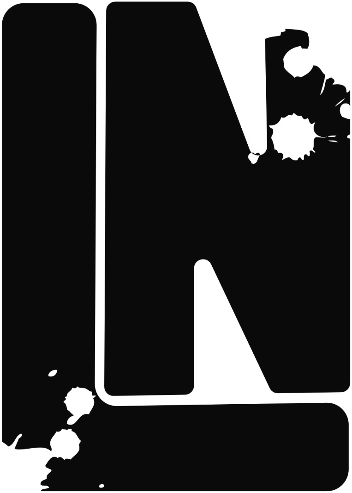
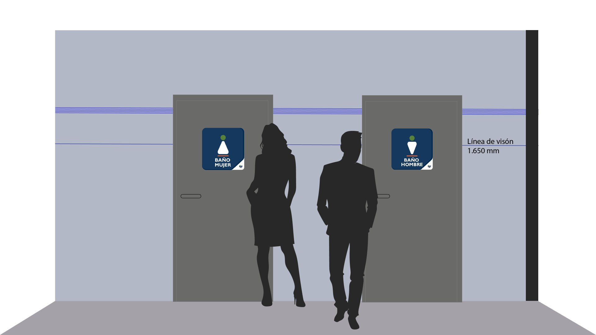
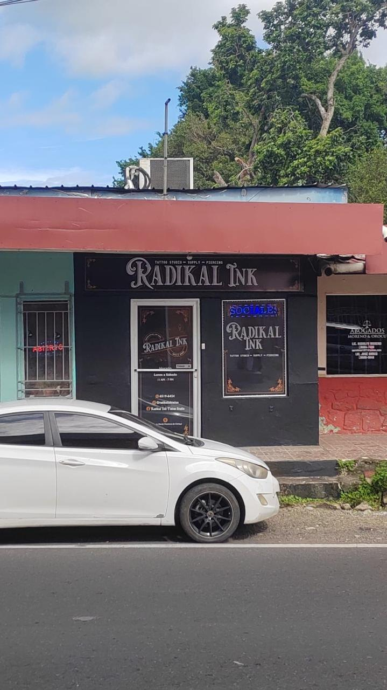
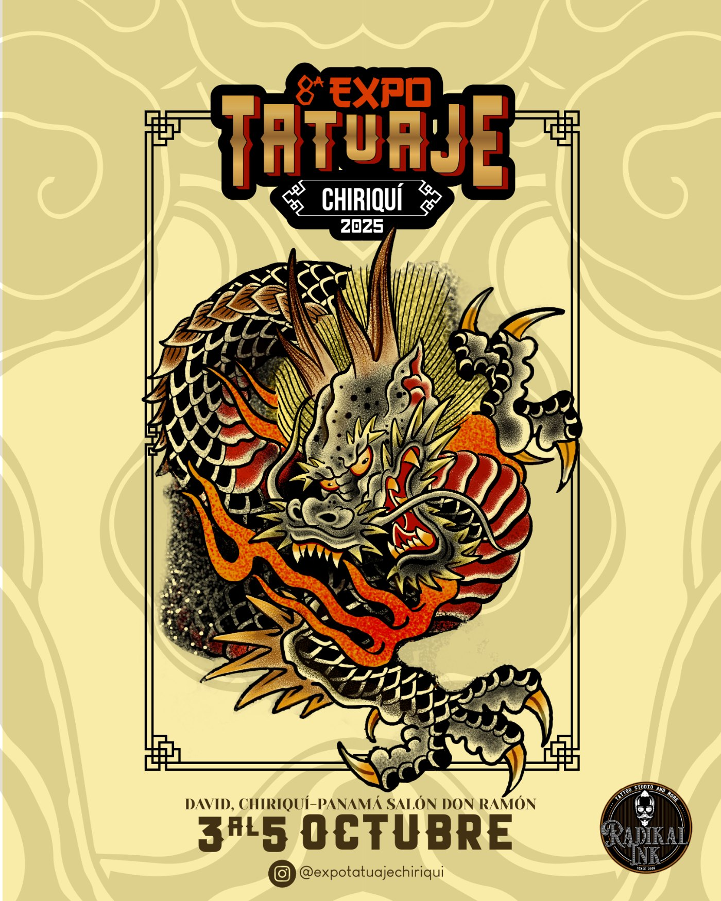
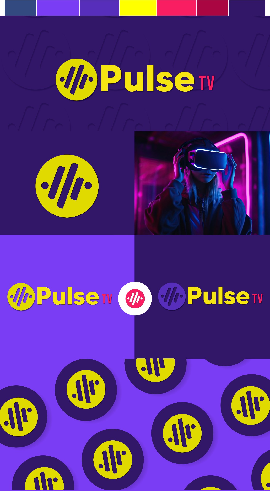

<div align="center">



# Loydeth Núñez — Portafolio

### diseño con *mucho* carácter /

Diseñadora gráfica de profesión y creadora visual por vocación.
Branding · Contenido para redes · Diseño editorial · Dirección de arte

`N.º 01 — 2026` · `Panamá · Rep. Dominicana` · `+4 años`

**[→ Ver el portafolio en vivo: loydeth.vercel.app](https://loydeth.vercel.app)**

[Instagram](https://www.instagram.com/design_loy/) · [LinkedIn](https://www.linkedin.com/in/loydeth/) · [Behance](https://www.behance.net/Loydeth/moodboards) · [loydeth16@gmail.com](mailto:loydeth16@gmail.com)

</div>

---

## § 00 — Sobre este repositorio

Este es el código de mi portafolio personal: una sola página donde reúno mis proyectos de identidad de marca, señalética, eventos y community management. Transformo la personalidad de las marcas en propuestas visuales que de verdad conecten con la gente, y este sitio se diseñó con ese mismo criterio: tipografía editorial, colores con actitud y detalles que se descubren al recorrerlo.

<p align="center">
  
</p>

---

## § 01 — Proyectos

| N.º | Proyecto | Qué hice | Dónde |
|---|---|---|---|
| 01 | **Interworld Freight** · Señalética | Sistema de 15 letreros de ubicación, acceso y emergencia con los colores de la marca, más su visualización en el espacio. | Rep. Dominicana |
| 02 | **Radikal Ink** · Rebranding | Rediseño del logo del primer estudio de tatuaje de Chiriquí y su aplicación en letrero, puerta, ventana, merch y papelería. Lenguaje *old school* con paleta negro, blanco y café dorado. | David, Chiriquí |
| 03 | **Expo Tatuaje Chiriquí** · Dirección creativa | Identidad de tres ediciones (2023, 2024 y 2025): logotipo que cambia cada año, plantillas para redes y piezas impresas como gafetes, tickets, stickers y camisetas. | Feria Internacional de David |
| 04 | **Pulse TV** · Logotipo | Isotipo, versiones de color y patrón a partir de una paleta de violetas, amarillo y fucsia. | — |
| 05 | **Interworld Freight** · Community management | Estrategia, gestión de comunidad, reportes y diseño de posts, carruseles, stories y reels en LinkedIn e Instagram desde 2022. | Panamá |

<p align="center">
  
  
  
  
</p>

### Resultados en redes · Interworld Freight

| | |
|---|---|
| **×2.8** | Comunidad en LinkedIn desde 2023 |
| **×2.4** | Alcance en LinkedIn en 2026 vs. 2025 |
| **×4.4** | Clics hacia la marca en 2026 |
| **100 %** | Crecimiento orgánico, sin pauta pagada |

---

## § 02 — Servicios

1. **Identidad de marca.** Logo, manual, paleta, tipografías, tono y aplicaciones, desde cero o como rediseño.
2. **Contenido para redes.** Contenido B2B y B2C: plantillas, carruseles, reels y estrategia visual mensual.
3. **Diseño editorial.** Revistas, reportes, catálogos y piezas impresas.
4. **Dirección de arte.** Conceptualización y dirección creativa de campañas y proyectos multicanal.
5. **Manuales de marca.** Guías claras y usables para que cualquier equipo mantenga la marca.

---

## § 03 — Cómo está hecho

Es un sitio estático: no necesita instalar nada ni compilar. React se carga desde CDN y Babel traduce los archivos `.jsx` directamente en el navegador.

- **React 18** y **Babel Standalone** (vía unpkg)
- **CSS propio** con modo claro y oscuro (se recuerda la preferencia de cada visitante)
- Tipografías de Google Fonts: *Instrument Serif*, *Space Grotesk*, *JetBrains Mono* y *Caveat*
- Detalles interactivos: cursor personalizado, animaciones al hacer scroll, comparadores antes/después y galerías con visor

```
├── index.html        # Página principal
├── styles.css        # Estilos, temas y modo oscuro
├── shapes.js         # Formas abstractas decorativas
├── app.jsx           # Estructura: hero, servicios, sobre mí y contacto
├── work.jsx          # Portafolio general + Interworld Freight (señalética)
├── radikal.jsx       # Radikal Ink
├── expo.jsx          # Expo Tatuaje Chiriquí
├── pulse.jsx         # Pulse TV
├── cm.jsx            # Community management
└── assets/           # Imágenes de cada proyecto
```

### Verlo en local

Como los `.jsx` se cargan por separado, hay que abrir el sitio con un servidor local (si abres el HTML con doble clic, el navegador lo bloquea):

```bash
npx serve .
```

Luego abre la dirección que aparece en la terminal.

### Publicarlo en Vercel

1. Importar el repositorio en Vercel con el preset **Other**, sin comando de build y con el directorio de salida en la raíz.
2. Cada cambio que se suba a la rama principal se publica solo.

---

<div align="center">

### ¿hacemos *algo* juntos?

Proyectos, colaboraciones y dirección de arte.
**[loydeth16@gmail.com](mailto:loydeth16@gmail.com)**

<sub>© 2026 Loydeth Núñez — Hecho con tinta y café. · Panamá / PAN</sub>

</div>
